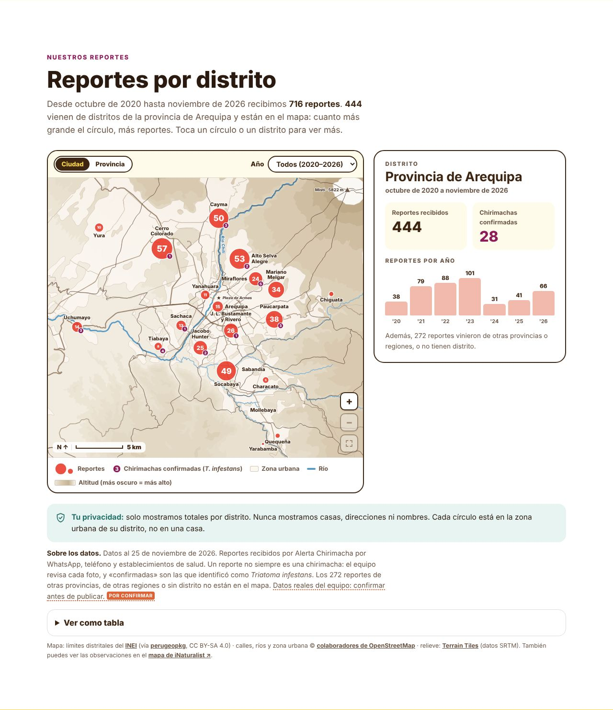

# Alerta Chirimacha website

Website for Alerta Chirimacha, the community surveillance system for chirimachas (*Triatoma infestans*) in Arequipa, Peru. Residents report an insect by WhatsApp; the site also shows where reports come from, on a map of the city and the province. Spanish first, with an English button.

This is a **draft for the Alerta Chirimacha team's review**, not the official site yet.


| Recognize it | Reports by district |
|---|---|
|  |  |

## Open the site

1. On this page, click **Code → Download ZIP**, then unzip it.
2. Open `site/index.html` in a browser. Keep the `site/` folder together: the page uses the photo in `assets/` and the video in `media/`.

Spanish is the default; the EN button (or `?lang=en` at the end of the address) switches to English.

- **Plan:** [PLAN.md](PLAN.md): audience, decisions, site map, data and privacy, the map, open questions.
- **Context for anyone picking up the work:** [HANDOFF.md](HANDOFF.md).

## Folders

- `site/index.html`: the built page. Don't edit it by hand.
- `site/source/template.html`: the page source. Bilingual text is written as `⟦Español||English⟧` (Spanish first), or `⟪Español||English⟫` inside SVG text.
- `site/source/build.py` and `mapdraw.py`: build `site/index.html`, including the map.
- `site/data/districts.csv`: the 29 districts of Arequipa province, their map labels and INEI ubigeo codes.
- `site/data/reports.json`: report totals by district and year, and a summary (no personal data). `reports-by-district.csv` has the same totals as a table.
- `site/data/live.json`: the address of the Google Sheet script. Empty means the page shows only the built-in snapshot.
- `site/data/map/`: the base map layers and their sources ([README](site/data/map/README.md)).
- `site/assets/`, `site/media/`: the team's photo and video (web versions).
- `tools/`: scripts that make the data files. `tools/apps-script/` has the Google Sheet script for live numbers.
- `docs/screenshots/`: the pictures in this README.

## Rebuild

From `site/source/` (Python 3, no extra packages):

```
python3 build.py template.html ../data ../index.html
```

## Report counts

**Automatic (recommended).** A small Google Apps Script attached to the team's report sheet serves district totals to the page, so new reports appear on the site within about 10 minutes. The sheet owner sets it up once: see [tools/apps-script/README.md](tools/apps-script/README.md). Then put the script's address in `site/data/live.json` and rebuild.

**Snapshot.** The page also carries the totals from the last export, used when the script isn't set up or can't be reached. To refresh them:

1. Download the DENUNCIAS tab (Google Sheets: File > Download > CSV) or get the Excel file. **Keep it outside this repository**: it has residents' names, phone numbers and addresses.
2. From the repository root:

   ```
   python3 tools/aggregate_reports.py /path/to/DENUNCIAS.csv site/data
   ```

   It reads only the activity, date, year, province, district and insect columns and writes district totals by year. (Excel files also need pandas and openpyxl.)
3. Rebuild the page, then delete the downloaded file.

Only totals per district go into `site/data`: never addresses, names, phone numbers or coordinates of homes.
